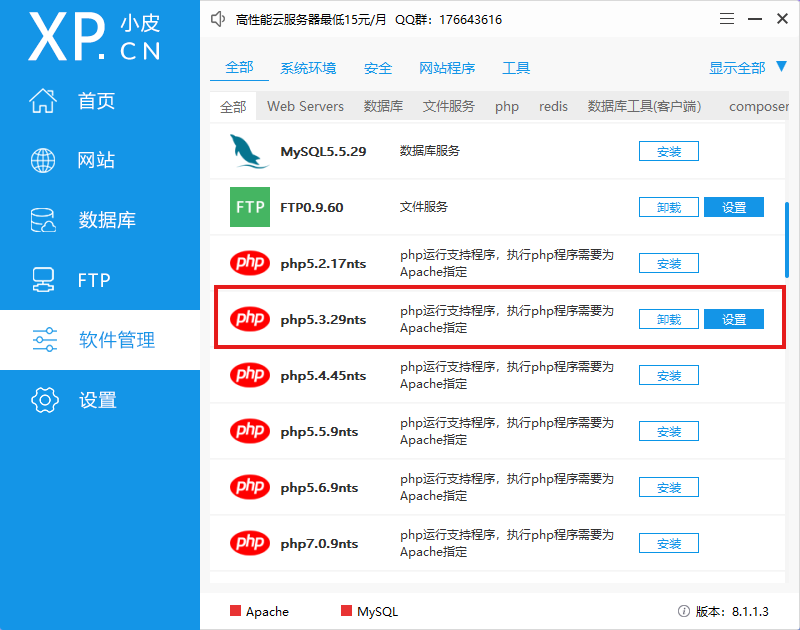
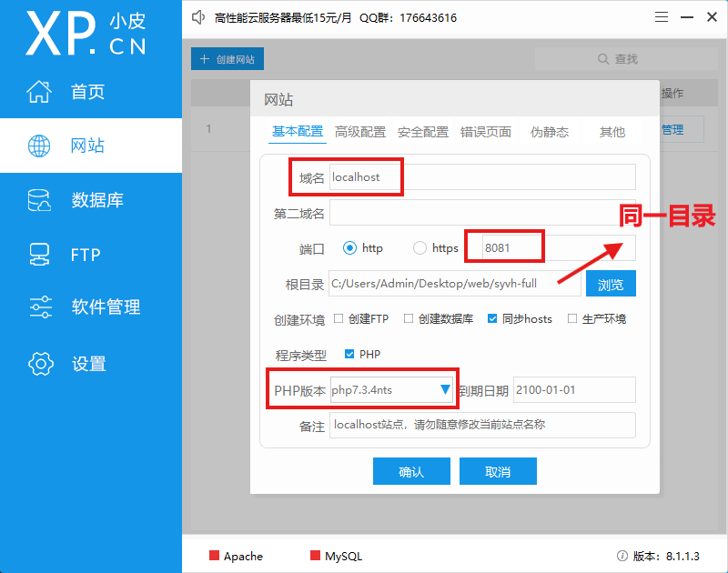
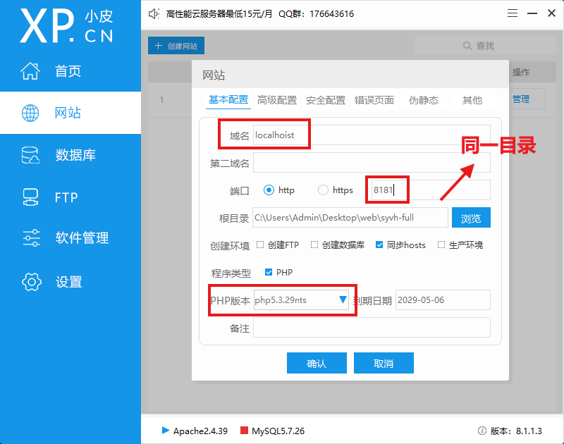
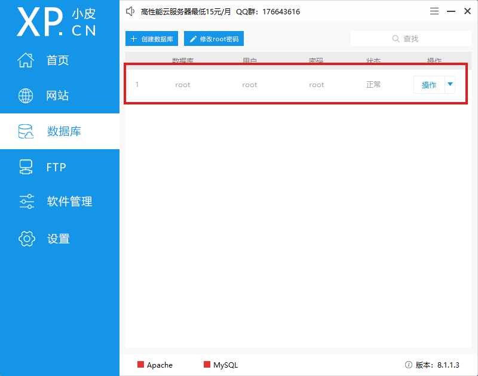
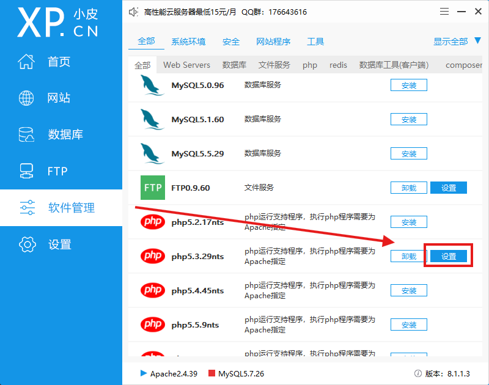
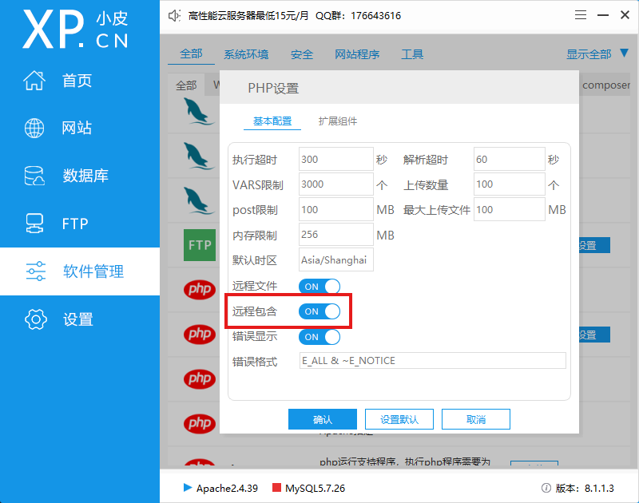

# syvh-full
 这是一个学习网络安全的平台 :)  
 在这个平台中集成了部分网络漏洞学习程序，可以帮助你更好的学习网络安全以及相关的漏洞
 
 也要感谢前辈们留下留下的宝藏，能给大家留下这么多学习的机会  
 以下是此平台中所有的靶场及出处

* DVWA:https://github.com/digininja/DVWA
* DVWA中文:https://github.com/Basyaact/DVWA-Chinese
* pikachu:https://github.com/zhuifengshaonianhanlu/pikachu
* xss-labs:https://github.com/do0dl3/xss-labs
* upload-lab:https://github.com/c0ny1/upload-labs
* sqli-labs:https://github.com/Audi-1/sqli-labs

再次宁谢各位前辈们的贡献
# 仅需要几个步骤即可运行
1. 下载phpstudy并且安装
2. 在phpstudy的软件管理中下载一个php5.3.29的版本
   
3. 在网站管理中更改localhost的默认端口为8081并且php版本为7.34
   
4. 创建一个新的站点地址为localhost端口为8181 php版本为5.3.29
   
5. 注意mysql的账户和密码是否是默认的root root，因为靶场数据库配置文件中都已经修改好了默认密码为root root
   
6. 此时此刻只要打开你的Apache和mysql服务器，然后访问ip+8081端口即可开始你的学习之旅

## 其他需要注意的事项
1. 如果你要做文件包含漏洞就要在php设置中打开文件包含选项

### version1.2 ©2024 Syyy 版权所有

